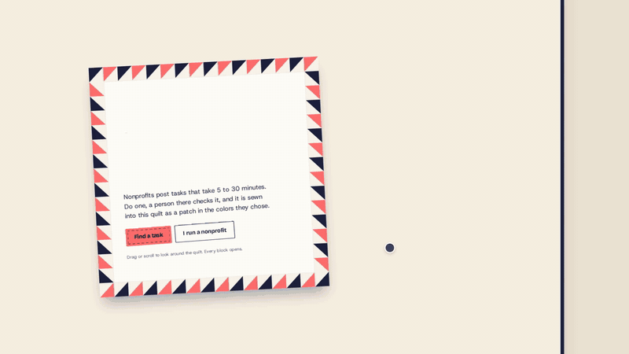
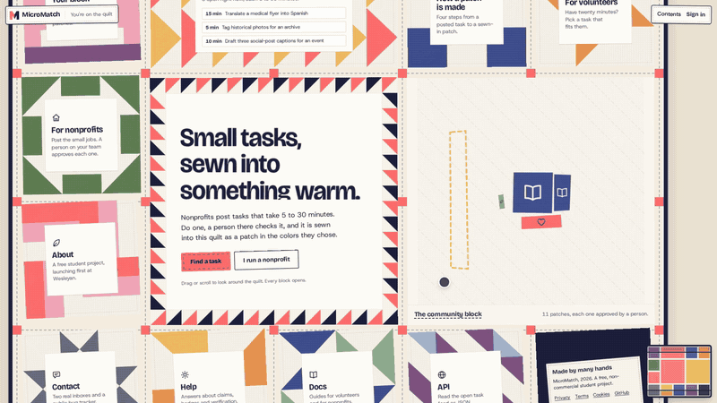
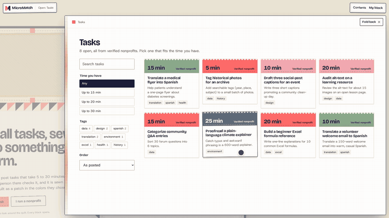
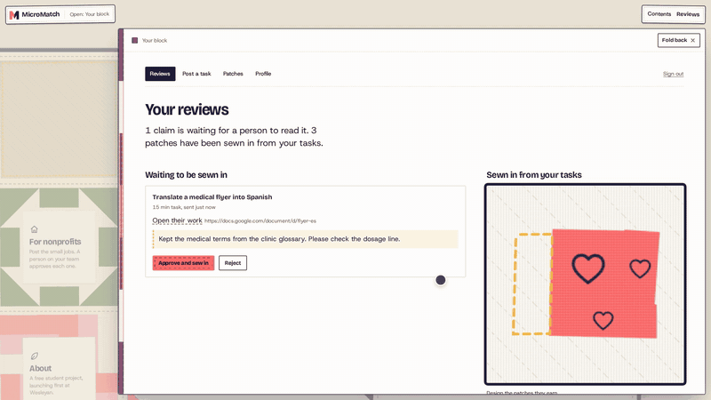
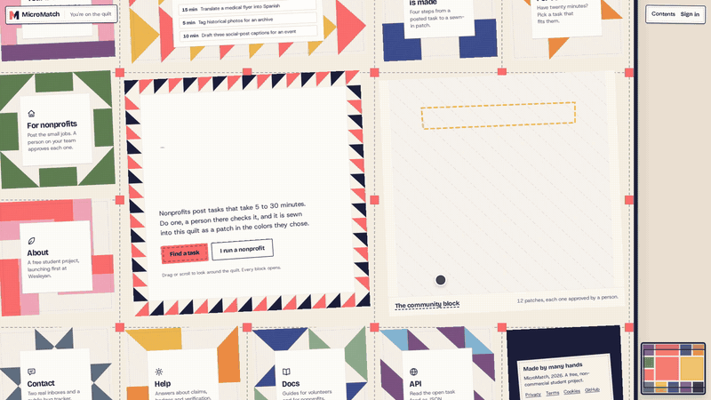
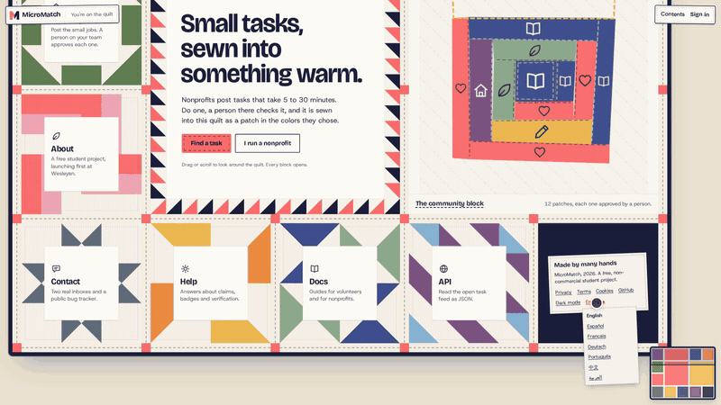
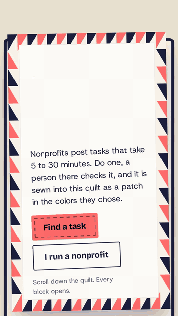
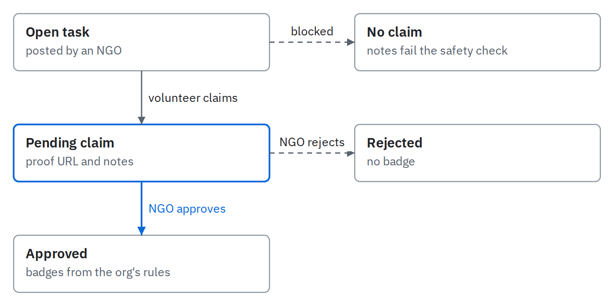

<div align="center">


<h1>MicroMatch</h1>

<br />

[](https://opensource.org/licenses/MIT)
[](https://kit.svelte.dev/)
[](https://appwrite.io/)
[](https://bun.sh/)

</div>

<br />

> **A micro-volunteering platform connecting nonprofits with skilled volunteers.** Complete quick 5 to 30-minute missions, help verified charities, and earn skill badges.

## 💡 What is MicroMatch?

Nonprofits and community organizations often need quick help with specific tasks (translating a document, designing a flyer, reviewing data, or writing copy), but recruiting full-time volunteers is slow and difficult. MicroMatch breaks volunteering down into bite-sized missions that busy people can complete in under 30 minutes.

Volunteers pick tasks that match their skills, submit their work, and earn verified digital badges for their portfolio. Nonprofits get tasks completed quickly by motivated contributors without endless administrative overhead.

## 🎬 Demo

<details open>
<summary>The quilt: the whole site on one cloth</summary>



</details>

<details>
<summary>Every block opens</summary>



</details>

<details>
<summary>A volunteer claims a task and sends their work</summary>



</details>

<details>
<summary>A person at the nonprofit approves it</summary>



</details>

<details>
<summary>The patch is sewn into the community block</summary>



</details>

<details>
<summary>Seven languages, and a dark mode</summary>



</details>

<details>
<summary>On a phone</summary>



</details>

There's a [trailer](trailer/) and a vertical [social cut](ui-demo/), both made in HyperFrames from the same footage.

## ✨ Key Features

- **Bite-sized task feed**: Filter by time (`≤15 / ≤20 / ≤30 min`), cause hashtags, or shortest duration first.
- **Volunteer portal**: Claim tasks, submit proof of work via file or link, track review status, and collect skill badges.
- **Nonprofit dashboard**: Post tasks with deadlines and volunteer caps, review submissions, and manage organization badge awards.
- **Charity verification**: Simple trust verification where nonprofits submit their tax or charity ID, verified against public registries with a verified badge displayed on their tasks.
- **Custom badge awards**: Organizations define custom award badges (label, color, icon, criteria) automatically awarded upon task approval.
- **Worldwide localization**: Paraglide provides type-safe, reviewed UI catalogs and locale-prefixed routes; self-hosted LibreTranslate handles user-created task content on the server.
- **Verification email**: Nonprofits get an email when an admin approves or rejects their verification, with the reason for a rejection.
- **The community quilt**: The site is one quilt. Every page is a block in it, and every claim a person approves is sewn into the middle as a patch in the colors of the badge that nonprofit designed.

## 🔄 How it works

A volunteer earns badges only when the NGO approves their claim.

<picture>
  <source media="(prefers-color-scheme: dark)" srcset="assets/diagrams/claim-lifecycle-dark.png">
  
</picture>

[Edit the diagram](assets/diagrams/claim-lifecycle.html).

Verification runs alongside this. An NGO submits its tax ID and a document, and an admin reviews the request. On approval, all of the org's tasks are marked verified and Plunk emails the NGO.

## 🚀 Tech stack

| | |
| --- | --- |
| **Framework** | [SvelteKit](https://kit.svelte.dev/) on [Vercel](https://vercel.com/) (`adapter-vercel`, `nodejs22.x` runtime) |
| **Runtime + package manager** | [Bun](https://bun.sh/) |
| **Backend** | [Appwrite Cloud](https://appwrite.io/) — Database (TablesDB), Auth, Storage, Teams |
| **Email** | [Plunk](https://useplunk.com/) as the transactional email provider (server-side HTTP API migration) |
| **NGO verification** | [ProPublica Nonprofit Explorer API](https://projects.propublica.org/nonprofits/api/) for US 501(c)(3) lookups |
| **Translation** | Self-hosted [LibreTranslate](https://libretranslate.com/) on an ARM64 Oracle VM behind `translate.micromatch.app` |
| **Static UI localization** | [Paraglide JS](https://paraglidejs.com/sveltekit) with committed catalogs for English, Spanish, French, German, Portuguese, Chinese, and Arabic |
| **UI** | Svelte 5 components and plain CSS tokens; GSAP and Lenis for the quilt's camera and panels; artwork drawn with Glaxnimate (see [DESIGN.md](DESIGN.md)) |
| **Testing** | [Vitest](https://vitest.dev/) (server modules, API endpoints, page loaders, quilt logic) and [Playwright](https://playwright.dev/) (functional flows, responsiveness, visual baselines) |

## 🏁 Getting started

Quick path:

```sh
git clone https://github.com/Builder106/micro-match.git
cd MicroMatch
bun install
cp .env.example .env

# Fill in Appwrite + Plunk + ProPublica + LibreTranslate values

bun run dev
```

The app runs at [http://localhost:5173](http://localhost:5173). Full setup (Appwrite resources, environment variables, project layout, conventions) lives in [CONTRIBUTING.md](CONTRIBUTING.md).

## Common scripts

```sh
bun run dev             # dev server with HMR
bun run build           # production build (uses adapter-vercel)
bun run check           # svelte-check + tsc
bun run test            # vitest
bun run seed            # (re)seed the demo NGO + tasks
bun run test:functional # browser flows against an in-memory preview
bun run test:visual     # visual baselines, desktop and phone
bun run verify:libretranslate # live health and API-key smoke check
```

## 🧪 Testing

- **Server modules** (vitest, node): helpers and DB access, with fetch and Appwrite mocked at the module boundary.
- **API endpoints** (vitest, node): auth gates, validation, and multi-step side effects.
- **Page loaders** (vitest, node): the data each route's `+page.server.ts` returns.

- **Browser flows** (Playwright): browse and filter the feed, open a task, sign up and pick a role, sign in, claim a task with proof, a nonprofit approving it, and the badge and patch appearing.
- **Responsiveness** (Playwright): no horizontal overflow at 320, 375, 768 and 1440 px, and the phone's Contents tag opening and folding back.
- **Visual baselines** (Playwright): every page, desktop and phone, in the quilt's zero state.

`bun run test:coverage` enforces 100% coverage and writes an HTML report to `coverage/`. The browser suites start a production preview with empty Appwrite variables and `PLAYWRIGHT_A11Y_HARNESS=1`, so they run against the in-memory store and never touch a real backend.

## 📦 Data model & Provisioning

Stored in Appwrite TablesDB (see [docs/appwrite-schema.md](docs/appwrite-schema.md) for full schema details):

| Table | Holds |
| --- | --- |
| `tasks` | Mission cards posted by NGOs (title, tags, time estimate, deadline, status, isVerified) |
| `claims` | Volunteer submissions for tasks (proofUrl, notes, status: pending / approved / rejected) |
| `badges` | Awarded badge instances (userId, taskId, label, color) |
| `badgeDefinitions` | Org-owned badge templates (orgId, label, criteria, taskId for task-specific) |
| `ngoVerifications` | Verification queue (orgName, country, taxId, docFileId, status, reason) |

Plus three Appwrite Teams (`volunteers`, `ngos`, `admins`) for role + moderation gating. Storage uses separate `avatars` and `verifications` buckets with file-level permissions. To automatically provision the database tables, attributes, and storage buckets:

```sh
bun scripts/setup-appwrite.ts
```

## 📝 Documentation

- [CONTRIBUTING.md](CONTRIBUTING.md) — local setup, project layout, conventions, PR process
- [docs/index.md](docs/index.md) — platform docs index
- [docs/volunteer.md](docs/volunteer.md) — volunteer guide
- [docs/ngo.md](docs/ngo.md) — NGO guide
- [docs/api.md](docs/api.md) — full API specification (public & authenticated endpoints)
- [docs/appwrite-schema.md](docs/appwrite-schema.md) — database schema and Appwrite resources specification
- [docs/faq.md](docs/faq.md) — FAQ

## 📜 License

MIT — see [LICENSE](LICENSE).
