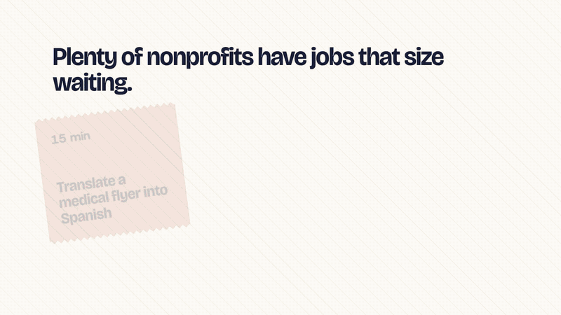

# MicroMatch trailer

<p align="center">
  <a href="micromatch-trailer.mp4"></a>
</p>

<p align="center"><a href="micromatch-trailer.mp4"><b>Watch the full trailer (45 s, with sound)</b></a></p>

Most volunteering asks for a Saturday morning, and plenty of people only have
fifteen minutes. The trailer starts there, on bare muslin, then pins up three
real tasks from the demo nonprofits and hands over to the site: the quilt, a
block opening, a patch being sewn in, and the same quilt in Arabic after dark.
Everything inside the quilt is real footage of the site. The cold open, the
swatches, the captions and the end card are HTML and GSAP.

## How it's made

It's built in HyperFrames. The shot list is in [STORYBOARD.md](STORYBOARD.md).

The clips in `public/clips/` are cut from takes recorded by
`e2e/capture/footage.mjs`. It runs the page on Playwright's fake clock and
screenshots every frame, so you get a clean 30 fps take on any machine. The
takes run against a local preview on the in-memory store with fictional
nonprofits, so nothing touches Appwrite. To record again after a site change:

```console
bun run build
node e2e/capture/footage.mjs
bash scripts/video/make-sfx.sh
bash scripts/video/cut-clips.sh
```

The cut list for this and the [social cut](../ui-demo/) lives in
`scripts/video/cut-clips.sh`, which also makes the README GIFs in
`docs/demos/`. To render:

```console
npx --yes hyperframes@0.8.116 check
npx --yes hyperframes@0.8.116 render --quality high --strict -o renders/micromatch-trailer.mp4
```

The full-quality render stays out of git (`renders/` is ignored). The MP4
above is a 720p copy for GitHub.

## Music

"Inspired" by Kevin MacLeod (CC BY 4.0), in `public/audio.mp3`. Keep the
credit from `public/CREDITS.md` with anything you publish. The sew sound comes
from `scripts/video/make-sfx.sh`.
