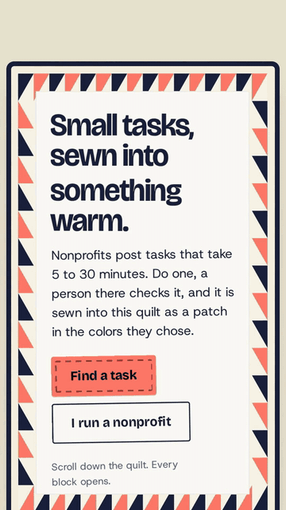

# MicroMatch social cut

<p align="center">
  <a href="micromatch-ui-demo.mp4"></a>
</p>

<p align="center"><a href="micromatch-ui-demo.mp4"><b>Watch the full video (35 s, with sound)</b></a></p>

A vertical cut for social feeds, made of the real site on a phone. A volunteer
with fifteen minutes finds a task, does it and sends a link to their work. Then
the video turns the phone sideways onto the nonprofit's desk, where a person
approves the work and it's sewn into the quilt. Nothing is mocked up. Every
screen is footage of the site, and only the captions, the table behind the
desktop shots and the end card are HTML and GSAP.

## How it's made

The footage comes from `e2e/capture/footage.mjs`, the same recorder as the
[trailer](../trailer/). The phone takes run at 360×640 and 3x scale, which is
exactly the cut's 1080×1920 frame, so nothing is scaled or cropped.

```console
bun run build
node e2e/capture/footage.mjs
bash scripts/video/make-sfx.sh
bash scripts/video/cut-clips.sh
```

The phone claim take has a moment between pages where the panel is blank, and
the cut list in `scripts/video/cut-clips.sh` skips each one so a tap goes
straight to the page it opens. The shot list is in
[STORYBOARD.md](STORYBOARD.md). Then render with HyperFrames:

```console
npx --yes hyperframes@0.8.116 check
npx --yes hyperframes@0.8.116 render --quality high --strict -o renders/micromatch-ui-demo.mp4
```

The full-quality render stays out of git (`renders/` is ignored). The MP4
above is a 720p copy for GitHub.

## Music

"Wallpaper" by Kevin MacLeod (CC BY 4.0), in `public/audio.mp3`. Keep the
credit from `public/CREDITS.md` with anything you publish. The pin and sew
sounds come from `scripts/video/make-sfx.sh`.
